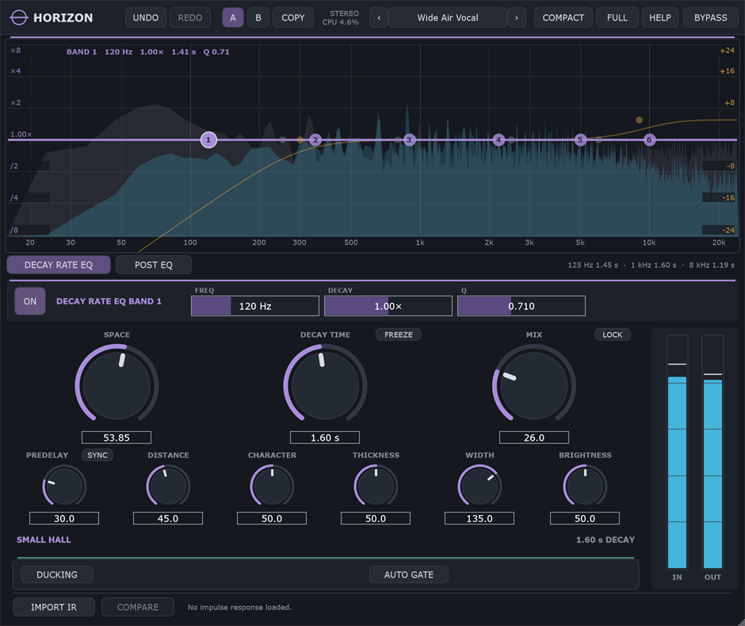
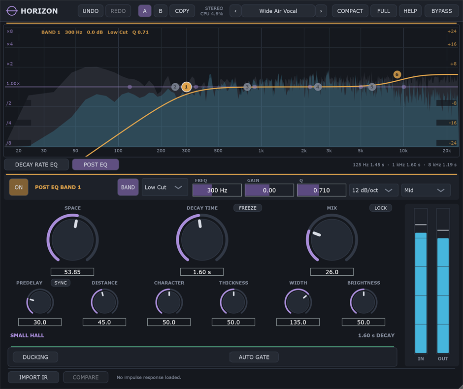

# Horizon

**A free, open-source algorithmic reverb, from small rooms to boundless spaces, in
stereo or immersive surround.**

Horizon covers fourteen room models on one smooth **Space** control, with a decay time
you set independently of the room. It adds a decay-rate EQ, a post EQ, ducking, an auto
gate and impulse-response matching, and runs on layouts up to 9.1.6. It is part of
the **Equinox Audio** family alongside [Equinox](https://github.com/JDMcE/Equinox) (EQ),
[Meridian](https://github.com/JDMcE/Meridian) (compressor) and
[Zenith](https://github.com/JDMcE/Zenith) (limiter).



<p align="center">
<br>
<sub>Post EQ: shape the tone of the tail, per band in Mid, Side or any speaker group</sub>
</p>

## Features

- **14 room models on one stepless Space control**: Ambience, Small Room, Studio,
  Live Room, Chamber, Bright Plate, Warm Plate, Small Hall, Concert Hall, Large Hall,
  Arena, Cathedral, Vast Space and Boundless. Every position in between is a real
  blend of its two neighbours
- **Absolute decay time** from 100 ms to 30 s, independent of the room
- **Distance, Character, Thickness, Brightness and Width** (mono-safe at every setting)
- **Freeze** for infinite sustain
- **Predelay** up to 500 ms, optionally synced to host tempo
- **6-band Decay Rate EQ** inside the reverb, to control how long each frequency rings
- **6-band Post EQ** on the reverb output, with per-band Mid/Side/speaker targeting
- **Ducking** and **Auto Gate**, triggered by the input or an external sidechain
- **Impulse response matching**: load a WAV/AIFF/FLAC IR and Horizon fits its own
  controls to it, then A/B against the real convolution
- **Mono, stereo, 5.1, 7.1, 7.1.4 and 9.1.6**. One shared room is heard from every
  speaker, at about 2.6x the CPU of stereo rather than one reverb per speaker
- **Presets** organised by source (what you're putting the reverb on), **A/B comparison**
  with independent undo per slot, a **Mix lock**, and **MIDI Learn** on every control
- Built-in manual, hover hints, keyboard control, high-contrast mode, scalable text,
  compact and full-screen layouts, and a freely resizable window

## Download & install

Download the latest build from the
[Releases page](https://github.com/JDMcE/Horizon/releases).

**Windows (64-bit VST3):**

1. Unzip the download.
2. Copy `Horizon.vst3` into `C:\Program Files\Common Files\VST3\`.
3. Restart your DAW or rescan plugins. Horizon appears under **Equinox Audio**.

Prebuilt releases are Windows-only for now. On other platforms you can build from
source (see [For developers](#for-developers)).

## Quick start

1. Start from a preset (press `P` to open the browser).
2. Set **Space** for the kind of room and **Decay Time** for how long it rings. They
   are independent, so you can hear the same three-second tail in a small room or a
   cathedral.
3. Set **Predelay** to keep the source in front of its tail, and **Distance** for how
   far into the room you're standing.
4. Blend with **Mix**, or set it to 100% and use Horizon on an aux/send.
5. If the low end gets crowded, pull band 1 of the **Decay Rate EQ** down to about
   0.35x rather than reaching for a high-pass.

The full manual is built in: click **HELP → Open Manual**. Hover any control (or press
`H`) for a short explanation.

## Tips

- **Right-click Space** to jump straight to a named room. **Right-click Decay Time**
  to set the room's natural decay.
- **Decay Rate EQ vs Post EQ:** the Decay Rate EQ changes *how long* each part of the
  spectrum rings. The Post EQ changes the *tone* of the tail without changing its
  length. Press `E` to switch the display between them.
- **Freeze** while something is ringing, then mute the source and play over the top.
- **Ducking** keeps the reverb down while the source plays and lets it bloom in the
  gaps. **Auto Gate** cuts the tail when the source stops. Both affect only the
  reverb, never the dry signal.
- **LOCK** beside Mix keeps your blend when you load presets or switch A/B.
- In surround, the LFE channel passes through untouched.

## Keyboard shortcuts

| Keys | Action |
|---|---|
| `Ctrl+Z` | Undo (active A/B slot) |
| `Ctrl+Shift+Z` / `Ctrl+Y` | Redo |
| `A` / `B` | Switch to state A / B |
| `C` | Copy current state to the other slot |
| `P` | Open / close the preset browser |
| `[` / `]` | Previous / next preset |
| `E` | Switch the display between the two EQ sections |
| `K` | Toggle compact layout |
| `F` | Toggle full screen |
| `H` | Toggle help hints bar |
| `F1` | Keyboard shortcuts overlay |
| `Esc` | Close overlay / browser / full screen |
| `Tab` / `Shift+Tab` | Move focus between controls |
| Arrow keys | Adjust the focused control |
| `Shift` + drag | Fine adjustment on any knob |
| Right-click | MIDI Learn (and Space's room list) |

## Presets

Factory presets are built in. User presets are plain `.hrzn` files in
`Documents\Horizon\Presets`, so they are easy to back up, sync or share. Use
**IMPORT** / **EXPORT** in the browser to move them between machines.

## Feedback

Found a bug or have an idea? Please
[open an issue](https://github.com/JDMcE/Horizon/issues).

---

## For developers

### Building

Requirements: CMake 3.22+ and a C++20 compiler (developed with Visual Studio 2022).

Horizon shares code with the rest of the family through
[jdm_shared](https://github.com/JDMcE/jdm_shared), which must be checked out next to
this repository:

```
some-folder/
  Horizon/
  jdm_shared/
```

```
git clone https://github.com/JDMcE/Horizon.git
git clone https://github.com/JDMcE/jdm_shared.git
cd Horizon
git clone --depth 1 --branch 8.0.14 https://github.com/juce-framework/JUCE.git libs/JUCE
cmake -B build
cmake --build build --config Release
```

Targets:

- `horizon_All`: everything below
- `horizon_VST3` / `horizon_Standalone`: the plugin
  (VST3 output: `build/horizon_artefacts/Release/VST3/Horizon.vst3`)
- `horizon_tests`: offline DSP verification harness (run the built exe; it exits
  non-zero on failure)

### How the surround engine works

One 16-line feedback delay network serves every layout, and each speaker reads it
through its own Walsh row. An immersive session is one room heard from fifteen places
rather than fifteen reverbs, so it costs about 2.6x a stereo instance rather than
fifteen times one. Neighbouring speakers are cross-fed by an amount that falls off with
the angle between them. The LFE is passed through untouched.

### Project layout

```
src/
  Parameters.h          parameter IDs, ranges, APVTS layout
  PluginProcessor.*     audio processing, routing, metering, state
  PluginEditor.*        UI: header, display, knobs, EQ band rows
  StateManager.h        forwarder for the shared A/B + undo manager
  dsp/
    ReverbEngine.h      FDN tank, early reflections, modulation
    RoomModels.h        the fourteen room models behind Space
    SpeakerLayout.h     channel layouts up to 9.1.6, per-speaker taps
    DecayEq.h           in-loop decay-rate EQ
    PostEq.h            wet-path post EQ
    DuckGate.h          ducking + auto gate
    IrFile.h / IrAnalysis.h / IrMatch.h   impulse-response import, analysis and fitting
    DelayLine.h, FilterCoeffs.h, AnalyzerFifo.h
  presets/              product config + factory presets for the shared preset manager
  ui/
    ReverbDisplay.*     decay/EQ display
    HelpTexts.h         tooltips, shortcut table and the embedded manual
  util/                 tempo sync, note names
test/
  DspTests.cpp          offline DSP verification harness
```

## License

Horizon is free software, released under the GNU Affero General Public License v3.0;
see [LICENSE](LICENSE). It is built on [JUCE](https://juce.com), used under JUCE's
AGPLv3 open-source licence.
